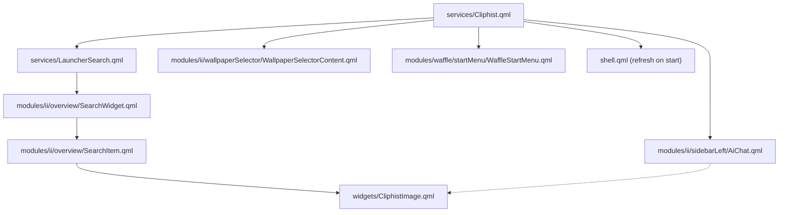

# Comprehensive Analysis: Clipboard Feature in Illogical Impulse (`ii`)

This report provides an exhaustive, code-verified technical analysis of the clipboard management system within the Illogical Impulse (`ii`) Quickshell configuration. It covers clipboard capture, indexing, decoding, the search launcher UI, user interactions, metadata handling, tool dependencies, and cross-module shared usage.

---

## 1. File Inventory & Responsibilities

The clipboard functionality spans backend services, daemon hooks, UI delegates, and search integration. Below is every file involved, using paths relative to the `ii` folder (`/home/nitesh/.config/quickshell/ii`), along with external Hyprland integration files:

### Primary Clipboard System Files
| Relative File Path | Purpose |
| :--- | :--- |
| [`services/Cliphist.qml`](file:///home/nitesh/.config/quickshell/ii/services/Cliphist.qml) | Singleton service that interfaces with the `cliphist` CLI (list, decode, copy, paste, delete, wipe, superpaste) and exposes the `cliphistService` IPC handler. |
| [`modules/common/widgets/CliphistImage.qml`](file:///home/nitesh/.config/quickshell/ii/modules/common/widgets/CliphistImage.qml) | Async thumbnail decoder and viewer that extracts cached binary image data from cliphist into `/tmp/quickshell/media/cliphist/`, scales it, and applies optional Gaussian blur for work safety. |
| [`services/LauncherSearch.qml`](file:///home/nitesh/.config/quickshell/ii/services/LauncherSearch.qml) | Coordinates search queries; intercepts the `;` prefix, queries `Cliphist.fuzzyQuery()`, constructs `LauncherSearchResult` items with Copy and Delete actions, and implements `:superpaste` and `:wipeclipboard`. |
| [`modules/common/models/LauncherSearchResult.qml`](file:///home/nitesh/.config/quickshell/ii/modules/common/models/LauncherSearchResult.qml) | Data object contract defining fields (`name`, `rawValue`, `type`, `actions`, `execute`, `blurImage`, etc.) passed to search item delegates. |
| [`modules/ii/overview/Overview.qml`](file:///home/nitesh/.config/quickshell/ii/modules/ii/overview/Overview.qml) | Overview overlay container providing `toggleClipboard()`, the `search.clipboardToggle()` IPC handler, and the `overviewClipboardToggle` GlobalShortcut. |
| [`modules/ii/overview/SearchWidget.qml`](file:///home/nitesh/.config/quickshell/ii/modules/ii/overview/SearchWidget.qml) | Search popup view hosting the input bar and `ListView` of results, managing debounced model binding and list navigation. |
| [`modules/ii/overview/SearchBar.qml`](file:///home/nitesh/.config/quickshell/ii/modules/ii/overview/SearchBar.qml) | Search input field detecting the `;` clipboard prefix, rendering the Gem shape with `content_paste_search` icon, and directing keyboard navigation (Up/Down/Enter). |
| [`modules/ii/overview/SearchItem.qml`](file:///home/nitesh/.config/quickshell/ii/modules/ii/overview/SearchItem.qml) | Delegate component for search entries; renders fuzzy search match highlighting, copied checkmark indicator, `CliphistImage` previews, and hover buttons (Copy, Delete). |
| [`modules/common/functions/StringUtils.qml`](file:///home/nitesh/.config/quickshell/ii/modules/common/functions/StringUtils.qml) | String helper providing `cleanCliphistEntry()` (strips ID and tab separator), `shellSingleQuoteEscape()` for safe bash command execution, and HTML escape utilities. |
| [`modules/common/functions/Fuzzy.qml`](file:///home/nitesh/.config/quickshell/ii/modules/common/functions/Fuzzy.qml) | QML wrapper around `fuzzysort.js` providing search ranking and pre-prepared search targets for clipboard entries. |
| [`modules/common/Directories.qml`](file:///home/nitesh/.config/quickshell/ii/modules/common/Directories.qml) | Defines the temporary decode path `cliphistDecode` (`/tmp/quickshell/media/cliphist`) and wipes/recreates it on startup. |
| [`modules/common/Config.qml`](file:///home/nitesh/.config/quickshell/ii/modules/common/Config.qml) | Stores configuration options including `search.prefix.clipboard` (`";"`), `search.sloppy`, `hacks.arbitraryRaceConditionDelay`, and `workSafety.enable.clipboard`. |
| [`shell.qml`](file:///home/nitesh/.config/quickshell/ii/shell.qml) | Quickshell root shell component; triggers initial clipboard cache loading via `Cliphist.refresh()` on startup. |

### External Integration & Hyprland Hooks
| File Path | Purpose |
| :--- | :--- |
| `~/.config/hypr/hyprland/execs.lua` | Autostarts `wl-paste --type text` and `wl-paste --type image` watchers that run `cliphist store` and notify Quickshell via `qs -c $qsConfig ipc call cliphistService update`. |
| `~/.config/hypr/hyprland/keybinds.lua` | Binds `SUPER + V` to `quickshell:overviewClipboardToggle` (with fallback to `cliphist list \| fuzzel \| cliphist decode \| wl-copy` if Quickshell is not running). |

### Ancillary Consumers in Other Modules
| Relative File Path | Purpose |
| :--- | :--- |
| [`modules/ii/sidebarLeft/AiChat.qml`](file:///home/nitesh/.config/quickshell/ii/modules/ii/sidebarLeft/AiChat.qml) | Inspects `Cliphist.entries[0]` to allow attaching recently copied images or file paths to Gemini/AI chat prompts. |
| [`modules/ii/wallpaperSelector/WallpaperSelectorContent.qml`](file:///home/nitesh/.config/quickshell/ii/modules/ii/wallpaperSelector/WallpaperSelectorContent.qml) | Inspects `Cliphist.entries[0]` to enable setting copied image URLs or file paths directly as the desktop wallpaper. |
| [`modules/waffle/startMenu/WaffleStartMenu.qml`](file:///home/nitesh/.config/quickshell/ii/modules/waffle/startMenu/WaffleStartMenu.qml) | Provides `toggleClipboard()` and `overviewClipboardToggle` GlobalShortcut in the Windows-style Waffle panel family. |
| [`modules/waffle/startMenu/StartMenuContext.qml`](file:///home/nitesh/.config/quickshell/ii/modules/waffle/startMenu/StartMenuContext.qml) | Declares the Clipboard context search category for the Waffle start menu. |
| [`modules/waffle/taskView/WaffleTaskView.qml`](file:///home/nitesh/.config/quickshell/ii/modules/waffle/taskView/WaffleTaskView.qml) | Provides IPC handler `search.clipboardToggle()` for the Waffle task view. |
| [`modules/settings/GeneralConfig.qml`](file:///home/nitesh/.config/quickshell/ii/modules/settings/GeneralConfig.qml) | Settings page for toggling `Config.options.workSafety.enable.clipboard`. |
| [`modules/settings/ServicesConfig.qml`](file:///home/nitesh/.config/quickshell/ii/modules/settings/ServicesConfig.qml) | Settings page for customizing `Config.options.search.prefix.clipboard`. |

---

## 2. History Collection Mechanism

### Watcher Architecture (`wl-paste` & `cliphist`)
Clipboard history collection is orchestrated outside Quickshell via Hyprland's startup execution script (`~/.config/hypr/hyprland/execs.lua` lines 19–21):
```lua
hl.on("hyprland.start", function ()
    ...
    -- Clipboard: history
    hl.exec_cmd("wl-paste --type text --watch bash -c 'cliphist store && qs -c $qsConfig ipc call cliphistService update'")
    hl.exec_cmd("wl-paste --type image --watch bash -c 'cliphist store && qs -c $qsConfig ipc call cliphistService update'")
end)
```
1. **Daemon Processes**: Two independent `wl-paste` background processes are spawned on Hyprland startup: one for MIME type `text` and one for `image`.
2. **Ingestion & IPC Pipeline**:
   - When any client window copies text or an image to the Wayland clipboard, `wl-paste` pipes the raw data into standard input of `cliphist store`.
   - Upon successful storage (`&&`), it immediately executes `qs -c $qsConfig ipc call cliphistService update`.
   - Quickshell's `IpcHandler` in `services/Cliphist.qml` receives the `update` call and immediately triggers `Cliphist.refresh()`.

### Storage & Database Path
- **Database Path**: `cliphist` defaults to `/home/nitesh/.cache/cliphist/db`.
- **Config File**: Checked at `/home/nitesh/.config/cliphist/config` (verified non-existent on this system).
- **Current Database File Size**: 45,191,168 bytes (~45 MB).

### Storage Limits & Deduplication
Because no custom `~/.config/cliphist/config` or CLI flags override the defaults in `execs.lua`, standard cliphist limits apply:
- **`max-items`**: 750 items (oldest entries roll off when item 751 is stored).
- **`max-dedupe-search`**: 100 entries (checks the last 100 entries for exact duplicates; if found, moves the duplicate to the top rather than appending).
- **`min-store-length`**: 0 characters (no minimum size restriction).
- **`preview-width`**: 100 characters (text previews generated by `cliphist list` are capped at 100 characters).
- **Max item size limit**: No explicit size cap set in config; cliphist stores images and large texts up to available memory/disk.

---

## 3. History Retrieval, Decoding, & Refreshing

### Exact CLI Commands Used
- **Listing History**:
  `cliphist list`
  Ran asynchronously via `Process` (`readProc`) in `services/Cliphist.qml`.
- **Decoding Text/Image for Copying**:
  `printf '${StringUtils.shellSingleQuoteEscape(entry)}' | cliphist decode | wl-copy`
  Executed detached in `Cliphist.copy(entry)`.
- **Decoding for Paste** (Internal function):
  `printf '${StringUtils.shellSingleQuoteEscape(entry)}' | cliphist decode | wl-copy && wl-paste`
  Executed detached in `Cliphist.paste(entry)`.
- **Decoding Image for Thumbnail Preview**:
  `[ -f ${imageDecodeFilePath} ] || echo '${StringUtils.shellSingleQuoteEscape(root.entry)}' | ${Cliphist.cliphistBinary} decode > '${imageDecodeFilePath}'`
  Ran asynchronously in `modules/common/widgets/CliphistImage.qml`.
- **Deleting Single Entry**:
  `echo '${StringUtils.shellSingleQuoteEscape(deleteProc.entry)}' | cliphist delete`
  Ran via `Process` (`deleteProc`) in `Cliphist.qml`.
- **Wiping Entire History**:
  `cliphist wipe`
  Ran via `Process` (`wipeProc`) in `Cliphist.qml`.

### Entry Parsing & Type Detection
`readProc.stdout: SplitParser` streams output lines into `readProc.buffer`. On process completion (`exitCode === 0`), `root.entries` is updated.
- **Entry Structure**: `<id>\t<preview-text>`
- **ID Extraction**:
  - `StringUtils.cleanCliphistEntry(entry)`: strips `/^\d+\t/`.
  - Type label in launcher: `entry.match(/^\s*(\S+)/)?.[1]` gives the numeric ID, prefixed with `#` (e.g. `"#16034"`).
- **Image / Binary Detection**:
  In `services/Cliphist.qml`:
  ```javascript
  function entryIsImage(entry) {
      return !!(/^\d+\t\[\[.*binary data.*\d+x\d+.*\]\]$/.test(entry))
  }
  ```
  Matches cliphist's binary indicator format: `[[ binary data <size> <mime> <width>x<height> ]]`.

### Thumbnail Decoding & Lifecycle (`CliphistImage.qml`)
- **Temp Storage Location**: `/tmp/quickshell/media/cliphist/<entryNumber>`.
- **Startup Cleanup**: In [`modules/common/Directories.qml`](file:///home/nitesh/.config/quickshell/ii/modules/common/Directories.qml#L62), `rm -rf '/tmp/quickshell/media/cliphist'; mkdir -p '/tmp/quickshell/media/cliphist'` runs on shell initialization.
- **On-Demand Decoding**: When `SearchItem.qml` loads a delegate representing an image, it instantiates `CliphistImage`. `decodeImageProcess` checks if the file already exists in `/tmp/quickshell/media/cliphist/`; if not, it pipes the entry line into `cliphist decode > /tmp/quickshell/media/cliphist/<id>`.
- **Dimension & Scale Calculation**:
  - `imageWidth`: parsed from `/(\d+)x(\d+)/` match index 1.
  - `imageHeight`: parsed from match index 2.
  - Sizing constraint: `maxWidth = contentColumn.width`, `maxHeight = 140 px`.
  - `scale = Math.min(maxWidth / imageWidth, maxHeight / imageHeight, 1)`.
  - `implicitWidth = imageWidth * scale`, `implicitHeight = imageHeight * scale`.
- **Delegate Cleanup**: On `Component.onDestruction`, `CliphistImage` executes `[ -f '${imageDecodeFilePath}' ] && rm -f '${imageDecodeFilePath}'` to prevent storage accumulation in `/tmp`.

### Refresh Triggers & Timers
The clipboard cache (`Cliphist.entries`) refreshes under five distinct events:
1. **Shell Boot**: `shell.qml` calls `Cliphist.refresh()` on `Component.onCompleted`.
2. **External Copy**: `wl-paste` executes `qs -c $qsConfig ipc call cliphistService update`, triggering `IpcHandler.update()` -> `Cliphist.refresh()`.
3. **Internal Clipboard Change**: Quickshell's internal clipboard property triggers `Connections { target: Quickshell; function onClipboardTextChanged() { delayedUpdateTimer.restart() } }`.
   - `delayedUpdateTimer`: Interval is `Config.options.hacks.arbitraryRaceConditionDelay` (20 ms). Once fired, runs `Cliphist.refresh()`.
4. **Item Deletion**: `deleteProc.onExited` calls `root.refresh()`.
5. **Wipe Command**: `wipeProc.onExited` calls `root.refresh()`.

---

## 4. User Interface & Search Interaction

### Opening Clipboard History
1. **Prefix Search**: Open Overview launcher (`SUPER + Space` or clicking the search bar) and type `;` (or custom `Config.options.search.prefix.clipboard`).
2. **Dedicated Hotkey**: `SUPER + V` invokes `quickshell:overviewClipboardToggle`, which calls `overviewScope.toggleClipboard()` in `Overview.qml`:
   - If overview is already open in clipboard mode, it closes overview.
   - Otherwise, sets searching text to `";"` and opens the overview popup.
3. **IPC**: `qs -c ii ipc call search clipboardToggle`.

### Search Bar Visuals (`SearchBar.qml`)
- When text starts with `;`:
  - `searchPrefixType` resolves to `SearchBar.SearchPrefixType.Clipboard`.
  - Search icon shape: `MaterialShape.Shape.Gem`.
  - Search icon symbol: `content_paste_search`.

### Search Item Delegate Layout (`SearchItem.qml`)
The list delegate is arranged horizontally in a `RowLayout`:
```
+-----------------------------------------------------------------------------------------------------+
| [Icon]  | #16034 (Entry ID in header)                                                 |  [Actions]  |
|         | [Check]  [Favicon]  Text preview with fuzzy highlight...                    |  [Copy]     |
|         | +---------------------------------------------------------+                 |  [Delete]   |
|         | | Decoded Image Preview (max 140px high)                  |                 |             |
|         | +---------------------------------------------------------+                 |             |
+-----------------------------------------------------------------------------------------------------+
```
1. **Header Row**: Styled text displaying `itemType`, which contains `#<id>` (e.g. `#16034`).
2. **Body Row**:
   - **Copied Indicator**: A rounded circle with a white `check` symbol appears if `itemName == Quickshell.clipboardText && root.cliphistRawString`, showing which item is currently in the active clipboard.
   - **Favicons**: If URLs (`http://`, `https://`) are detected inside the text, `Favicon` items fetch and render site icons.
   - **Preview Text**: Formatted with `Text.StyledText` and `Text.ElideRight`. Matching fuzzy search letters are wrapped in `<u><font color="${Appearance.colors.colPrimary}">...</u>`.
   - **Image Preview**: If `Cliphist.entryIsImage(root.cliphistRawString)` is true, a `Loader` instantiates `CliphistImage` with aspect-ratio fitting.
3. **Trailing Action Buttons**:
   - A `RowLayout` of square icon buttons (`RippleButton`, 34x34 px) with `StyledToolTip`:
     - **Copy**: Icon `content_copy`, runs `Cliphist.copy(entry)`.
     - **Delete**: Icon `delete`, runs `Cliphist.deleteEntry(entry)`.

### Keyboard Navigation & Shortcuts
- **Up / Down**: Handled in `SearchBar.qml` (`Keys.onPressed`). Increments or decrements `appResults.currentIndex`, skipping separator rows.
- **Enter / Return**:
  - In `SearchBar.qml`: Executes `entry.execute()` (`Cliphist.copy(entry)`) and sets `GlobalStates.overviewOpen = false`.
  - In `SearchItem.qml`: Triggers `root.clicked()`, closing Overview and copying the entry.
- **Shift + Enter**: **NOT implemented as a separate action**. Treated identically to Enter (copies entry and closes overview).
- **Shift + Delete**: In `SearchItem.qml` (`Keys.onPressed`), searches `root.entry.actions` for the action named `"Delete"` and executes `Cliphist.deleteEntry(entry)`.
- **Delete key (alone)**: Not handled; ignored.
- **Right-Click**: **NOT implemented**. `SearchItem.qml` does not set `altAction` on its `RippleButton`. Right-clicking produces no menu.
- **Tab**: Auto-completes the input field with the text of the currently selected entry.
- **Backspace**: Automatically refocuses the `SearchBar` text input and deletes characters.

### "Clear All" Action
There is no dedicated clear-all button in the UI list. The user must type the action command:
- **`:wipeclipboard`**: Handled in `services/LauncherSearch.qml` line 116. Executes `Cliphist.wipe()`, which runs `cliphist wipe` and triggers `Cliphist.refresh()`.

### Fuzzy Filtering Logic
When `;query` is typed, `services/LauncherSearch.qml` strips `;` via `StringUtils.cleanPrefix()` and calls `Cliphist.fuzzyQuery(searchString)`:
1. **Empty Query (`;`)**: Returns all `entries` in raw chronological order from `cliphist list`.
2. **Default Fuzzy Mode** (`Config.options.search.sloppy: false`):
   - Uses `preparedEntries`, which maps each entry to `{ name: Fuzzy.prepare(entryWithoutId), entry: a }`.
   - Calls `Fuzzy.go(search, preparedEntries, { all: true, key: "name" })`.
   - Returns matched entries sorted by score.
3. **Sloppy / Levenshtein Mode** (`Config.options.search.sloppy: true`):
   - Takes the first 100 entries.
   - Computes score with `Levendist.computeTextMatchScore(str.toLowerCase(), search.toLowerCase())`.
   - Filters by `scoreThreshold: 0.2` and sorts descending.

---

## 5. Item Actions & Overview Lifecycle

| Action | Trigger | Execution Mechanism | Auto-Paste? | Overview Window |
| :--- | :--- | :--- | :--- | :--- |
| **Select / Copy** | Left Click or Enter | `Cliphist.copy(entry)`: runs `printf '<entry>' \| cliphist decode \| wl-copy` | **No** (Copy only) | Closes immediately (`GlobalStates.overviewOpen = false`) |
| **Delete Entry** | Trash icon or `Shift + Delete` | `Cliphist.deleteEntry(entry)`: runs `echo '<entry>' \| cliphist delete` | N/A | **Remains open**; list refreshes via `onExited` |
| **Wipe History** | Search command `:wipeclipboard` | `Cliphist.wipe()`: runs `cliphist wipe` | N/A | Closes if Enter pressed on action |
| **Superpaste** | Search command `:superpaste N[i]` | `Cliphist.superpaste(count, isImage)`: sequences `cliphist decode \| wl-copy && sleep 0.05 && ydotool key ...` for N items | **Yes** (via `ydotool` keycodes `29:1 47:1 47:0 29:0`) | Closes |

> [!NOTE]
> Selecting an item does **not** simulate keystrokes or automatically paste into the active window. It only loads the entry into Wayland's clipboard via `wl-copy`. The user must manually press `Ctrl+V` in the target application.

---

## 6. Entry Metadata & CLI Inspection

### Available Metadata per Entry
| Field | Source | Available? | Notes |
| :--- | :--- | :--- | :--- |
| **ID** | `cliphist list` | **Yes** | Integer identifier (e.g. `16034`). |
| **Preview Text** | `cliphist list` | **Yes** | Text snippet up to 100 characters. |
| **MIME / Type** | `cliphist list` | **Partial** | Only identified as binary/image if it matches `[[ binary data ... ]]`. Text mime types are not differentiated. |
| **Dimensions** | `cliphist list` | **Yes (Images)** | Parsed via regex `(\d+)x(\d+)` (e.g. `444x368`). |
| **Data Size** | `cliphist list` | **Yes (Images)** | Included in string (e.g. `27 KiB`), but not parsed into a dedicated property. |
| **Timestamp** | `cliphist list` | **NO** | `cliphist` does not store or output creation or modification timestamps. |
| **Source App** | Wayland Protocol | **NO** | Wayland's `wlr-data-control` protocol isolates client window identities; source application is unknown. |

### Real CLI Output on This System

#### `cliphist version`
```text
version	0.7.0
config-path	/home/nitesh/.config/cliphist/config
db-path	/home/nitesh/.cache/cliphist/db
max-dedupe-search	100
max-items	750
min-store-length	0
preview-width	100
```

#### `cliphist list | head -5` *(redacted)*
```text
16034	Analyze the clipboard feature of this config (the clipboard history opened from the Overview launche…
16033	Make the content animations of the right sidebar bottom group tabs (Calendar, To Do, Timer) smooth a…
16032	Fix a visual bug with the active-tab indicator in the right sidebar bottom group's vertical navigati…
16031	[[ binary data 27 KiB png 444x368 ]]
16029	currenlt when i oen the rght side bar and open the "Timer" tab and close it and reopen it open the l…
```

---

## 7. Complete Code Listings

### A. Clipboard Service ([`services/Cliphist.qml`](file:///home/nitesh/.config/quickshell/ii/services/Cliphist.qml))
```qml
pragma Singleton
pragma ComponentBehavior: Bound

import qs.modules.common
import qs.modules.common.functions
import QtQuick
import Quickshell
import Quickshell.Io

Singleton {
    id: root
    // property string cliphistBinary: FileUtils.trimFileProtocol(`${Directories.home}/.cargo/bin/stash`)
    property string cliphistBinary: "cliphist"
    property real pasteDelay: 0.05
    property string pressPasteCommand: "ydotool key -d 1 29:1 47:1 47:0 29:0"
    property bool sloppySearch: Config.options?.search.sloppy ?? false
    property real scoreThreshold: 0.2
    property list<string> entries: []
    readonly property var preparedEntries: entries.map(a => ({
        name: Fuzzy.prepare(`${a.replace(/^\s*\S+\s+/, "")}`),
        entry: a
    }))
    function fuzzyQuery(search: string): var {
        if (search.trim() === "") {
            return entries;
        }
        if (root.sloppySearch) {
            const results = entries.slice(0, 100).map(str => ({
                entry: str,
                score: Levendist.computeTextMatchScore(str.toLowerCase(), search.toLowerCase())
            })).filter(item => item.score > root.scoreThreshold)
                .sort((a, b) => b.score - a.score)
            return results
                .map(item => item.entry)
        }

        return Fuzzy.go(search, preparedEntries, {
            all: true,
            key: "name"
        }).map(r => {
            return r.obj.entry
        });
    }

    function entryIsImage(entry) {
        return !!(/^\d+\t\[\[.*binary data.*\d+x\d+.*\]\]$/.test(entry))
    }

    function refresh() {
        readProc.buffer = []
        readProc.running = true
    }

    function copy(entry) {
        if (root.cliphistBinary.includes("cliphist")) // Classic cliphist
            Quickshell.execDetached(["bash", "-c", `printf '${StringUtils.shellSingleQuoteEscape(entry)}' | ${root.cliphistBinary} decode | wl-copy`]);
        else { // Stash
            const entryNumber = entry.split("\t")[0];
            Quickshell.execDetached(["bash", "-c", `${root.cliphistBinary} decode ${entryNumber} | wl-copy`]);
        }
    }

    function paste(entry) {
        if (root.cliphistBinary.includes("cliphist")) // Classic cliphist
            Quickshell.execDetached(["bash", "-c", `printf '${StringUtils.shellSingleQuoteEscape(entry)}' | ${root.cliphistBinary} decode | wl-copy && wl-paste`]);
        else { // Stash
            const entryNumber = entry.split("\t")[0];
            Quickshell.execDetached(["bash", "-c", `${root.cliphistBinary} decode ${entryNumber} | wl-copy; ${root.pressPasteCommand}`]);
        }
    }

    function superpaste(count, isImage = false) {
        // Find entries
        const targetEntries = entries.filter(entry => {
            if (!isImage) return true;
            return entryIsImage(entry);
        }).slice(0, count)
        const pasteCommands = [...targetEntries].reverse().map(entry => `printf '${StringUtils.shellSingleQuoteEscape(entry)}' | ${root.cliphistBinary} decode | wl-copy && sleep ${root.pasteDelay} && ${root.pressPasteCommand}`)
        // Act
        Quickshell.execDetached(["bash", "-c", pasteCommands.join(` && sleep ${root.pasteDelay} && `)]);
    }

    Process {
        id: deleteProc
        property string entry: ""
        command: ["bash", "-c", `echo '${StringUtils.shellSingleQuoteEscape(deleteProc.entry)}' | ${root.cliphistBinary} delete`]
        function deleteEntry(entry) {
            deleteProc.entry = entry;
            deleteProc.running = true;
            deleteProc.entry = "";
        }
        onExited: (exitCode, exitStatus) => {
            root.refresh();
        }
    }

    function deleteEntry(entry) {
        deleteProc.deleteEntry(entry);
    }

    Process {
        id: wipeProc
        command: [root.cliphistBinary, "wipe"]
        onExited: (exitCode, exitStatus) => {
            root.refresh();
        }
    }

    function wipe() {
        wipeProc.running = true;
    }

    Connections {
        target: Quickshell
        function onClipboardTextChanged() {
            delayedUpdateTimer.restart()
        }
    }

    Timer {
        id: delayedUpdateTimer
        interval: Config.options.hacks.arbitraryRaceConditionDelay
        repeat: false
        onTriggered: {
            root.refresh()
        }
    }

    Process {
        id: readProc
        property list<string> buffer: []

        command: [root.cliphistBinary, "list"]

        stdout: SplitParser {
            onRead: (line) => {
                readProc.buffer.push(line)
            }
        }

        onExited: (exitCode, exitStatus) => {
            if (exitCode === 0) {
                root.entries = readProc.buffer
            } else {
                console.error("[Cliphist] Failed to refresh with code", exitCode, "and status", exitStatus)
            }
        }
    }

    IpcHandler {
        target: "cliphistService"

        function update(): void {
            root.refresh()
        }
    }
}
```

---

### B. Clipboard Image Widget ([`modules/common/widgets/CliphistImage.qml`](file:///home/nitesh/.config/quickshell/ii/modules/common/widgets/CliphistImage.qml))
```qml
import qs.modules.common
import qs.modules.common.widgets
import qs.services
import qs.modules.common.functions
import Qt5Compat.GraphicalEffects
import QtQuick
import Quickshell
import Quickshell.Io

Rectangle {
    id: root
    property string entry
    property real maxWidth
    property real maxHeight
    property bool blur: false
    property string blurText: "Image hidden"

    property string imageDecodePath: Directories.cliphistDecode
    property string imageDecodeFileName: `${entryNumber}`
    property string imageDecodeFilePath: `${imageDecodePath}/${imageDecodeFileName}`
    property string source

    property int entryNumber: {
        if (!root.entry)
            return 0;
        const match = root.entry.match(/^(\d+)\t/);
        return match ? parseInt(match[1]) : 0;
    }
    property int imageWidth: {
        if (!root.entry)
            return 0;
        const match = root.entry.match(/(\d+)x(\d+)/);
        return match ? parseInt(match[1]) : 0;
    }
    property int imageHeight: {
        if (!root.entry)
            return 0;
        const match = root.entry.match(/(\d+)x(\d+)/);
        return match ? parseInt(match[2]) : 0;
    }
    property real scale: {
        return Math.min(root.maxWidth / imageWidth, root.maxHeight / imageHeight, 1);
    }

    color: Appearance.colors.colLayer1
    radius: Appearance.rounding.small
    implicitHeight: imageHeight * scale
    implicitWidth: imageWidth * scale

    Component.onCompleted: {
        decodeImageProcess.running = true;
    }

    Process {
        id: decodeImageProcess
        command: ["bash", "-c", `[ -f ${imageDecodeFilePath} ] || echo '${StringUtils.shellSingleQuoteEscape(root.entry)}' | ${Cliphist.cliphistBinary} decode > '${imageDecodeFilePath}'`]
        onExited: (exitCode, exitStatus) => {
            if (exitCode === 0) {
                root.source = imageDecodeFilePath;
            } else {
                console.error("[CliphistImage] Failed to decode image for entry:", root.entry);
                root.source = "";
            }
        }
    }

    Component.onDestruction: {
        Quickshell.execDetached(["bash", "-c", `[ -f '${imageDecodeFilePath}' ] && rm -f '${imageDecodeFilePath}'`]);
    }

    layer.enabled: true
    layer.effect: OpacityMask {
        maskSource: Rectangle {
            width: image.width
            height: image.height
            radius: root.radius
        }
    }

    StyledImage {
        id: image
        anchors.fill: parent

        source: Qt.resolvedUrl(root.source)
        fillMode: Image.PreserveAspectFit
        antialiasing: true
        asynchronous: true

        width: root.imageWidth * root.scale
        height: root.imageHeight * root.scale
    }

    Loader {
        id: blurLoader
        active: root.blur
        anchors.fill: image
        sourceComponent: GaussianBlur {
            source: image
            radius: 35
            samples: radius * 2 + 1

            Rectangle {
                anchors.fill: parent
                color: ColorUtils.transparentize(Appearance.colors.colLayer0, 0.5)

                Column {
                    anchors {
                        left: parent.left
                        right: parent.right
                        verticalCenter: parent.verticalCenter
                    }
                    MaterialSymbol {
                        visible: width <= image.width
                        anchors.horizontalCenter: parent.horizontalCenter
                        text: "visibility_off"
                        font.pixelSize: 28
                    }
                    StyledText {
                        visible: width <= image.width
                        anchors.horizontalCenter: parent.horizontalCenter
                        text: root.blurText
                        color: Appearance.colors.colOnSurface
                        font.pixelSize: Appearance.font.pixelSize.smallie
                    }
                }
            }
        }
    }
}
```

---

### C. Search Item Delegate ([`modules/ii/overview/SearchItem.qml`](file:///home/nitesh/.config/quickshell/ii/modules/ii/overview/SearchItem.qml))
```qml
// pragma NativeMethodBehavior: AcceptThisObject
import qs
import qs.services
import qs.modules.common
import qs.modules.common.models
import qs.modules.common.widgets
import qs.modules.common.functions
import QtQuick
import QtQuick.Layouts
import Quickshell
import Quickshell.Widgets
import Quickshell.Hyprland

RippleButton {
    id: root
    property LauncherSearchResult entry
    property string query
    property bool entryShown: entry?.shown ?? true
    property string itemType: entry?.type ?? Translation.tr("App")
    property string itemName: entry?.name ?? ""
    property var iconType: entry?.iconType
    property string iconName: entry?.iconName ?? ""
    property var itemExecute: entry?.execute
    property var fontType: switch(entry?.fontType) {
        case LauncherSearchResult.FontType.Monospace:
            return "monospace"
        case LauncherSearchResult.FontType.Normal:
            return "main"
        default:
            return "main"
    }
    property string itemClickActionName: entry?.verb ?? "Open"
    property string bigText: entry?.iconType === LauncherSearchResult.IconType.Text ? entry?.iconName ?? "" : ""
    property string materialSymbol: entry.iconType === LauncherSearchResult.IconType.Material ? entry?.iconName ?? "" : ""
    property string cliphistRawString: entry?.rawValue ?? ""
    property bool blurImage: entry?.blurImage ?? false
    
    visible: root.entryShown
    property int horizontalMargin: 10
    property int buttonHorizontalPadding: 10
    property int buttonVerticalPadding: 6
    property bool keyboardDown: false
    property bool forcedSelected: false
    readonly property bool selected: (root.hovered || root.focus || root.forcedSelected)

    implicitHeight: rowLayout.implicitHeight + root.buttonVerticalPadding * 2
    implicitWidth: rowLayout.implicitWidth + root.buttonHorizontalPadding * 2
    buttonRadius: Appearance.rounding.normal
    colBackground: (root.down || root.keyboardDown) ? Appearance.colors.colPrimaryContainerActive : 
        (selected ? Appearance.colors.colPrimaryContainer : 
        ColorUtils.transparentize(Appearance.colors.colPrimaryContainer, 1))
    colBackgroundHover: Appearance.colors.colPrimaryContainer
    colRipple: Appearance.colors.colPrimaryContainerActive
    property color colForeground: selected ? Appearance.colors.colOnPrimaryContainer : Appearance.m3colors.m3onSurface

    readonly property string highlightPrefix: `<u><font color="${Appearance.colors.colPrimary}">`
    readonly property string highlightSuffix: `</font></u>`
    // Note that this highlighting is independent from the search
    // It's close, but does not accurately represent how the fuzzy algorithm works
    function highlightContent(content, query) {
        if (!query || query.length === 0 || content == query || fontType === "monospace")
            return StringUtils.escapeHtml(content);

        let contentLower = content.toLowerCase();
        let queryLower = query.toLowerCase();

        let result = "";
        let lastIndex = 0;
        let qIndex = 0;

        for (let i = 0; i < content.length && qIndex < query.length; i++) {
            if (contentLower[i] === queryLower[qIndex]) {
                // Add non-highlighted part (escaped)
                if (i > lastIndex)
                    result += StringUtils.escapeHtml(content.slice(lastIndex, i));
                // Add highlighted character (escaped)
                result += root.highlightPrefix + StringUtils.escapeHtml(content[i]) + root.highlightSuffix;
                lastIndex = i + 1;
                qIndex++;
            }
        }
        // Add the rest of the string (escaped)
        if (lastIndex < content.length)
            result += StringUtils.escapeHtml(content.slice(lastIndex));

        return result;
    }
    property string displayContent: highlightContent(root.itemName, root.query)

    property list<string> urls: {
        if (!root.itemName) return [];
        // Regular expression to match URLs
        const urlRegex = /https?:\/\/[^\s<>"{}|\\^`[\]]+/gi;
        const matches = root.itemName?.match(urlRegex)
            ?.filter(url => !url.includes("…")) // Elided = invalid
        return matches ? matches : [];
    }
    
    PointingHandInteraction {}

    background {
        anchors.fill: root
        anchors.leftMargin: root.horizontalMargin
        anchors.rightMargin: root.horizontalMargin
    }

    onClicked: {
        GlobalStates.overviewOpen = false
        root.itemExecute()
    }
    Keys.onPressed: (event) => {
        if (event.key === Qt.Key_Delete && event.modifiers === Qt.ShiftModifier) {
            const deleteAction = root.entry.actions.find(action => action.name == Translation.tr("Delete"));

            if (deleteAction) {
                deleteAction.execute()
            }
        } else if (event.key === Qt.Key_Return || event.key === Qt.Key_Enter) {
            root.keyboardDown = true
            root.clicked()
            event.accepted = true;
        }
    }
    Keys.onReleased: (event) => {
        if (event.key === Qt.Key_Return || event.key === Qt.Key_Enter) {
            root.keyboardDown = false
            event.accepted = true;
        }
    }

    RowLayout {
        id: rowLayout
        spacing: iconLoader.sourceComponent === null ? 0 : 10
        anchors.fill: parent
        anchors.leftMargin: root.horizontalMargin + root.buttonHorizontalPadding
        anchors.rightMargin: root.horizontalMargin + root.buttonHorizontalPadding

        // Icon
        Loader {
            id: iconLoader
            active: true
            sourceComponent: switch(root.iconType) {
                case LauncherSearchResult.IconType.Material:
                    return materialSymbolComponent
                case LauncherSearchResult.IconType.Text:
                    return bigTextComponent
                case LauncherSearchResult.IconType.System:
                    return iconImageComponent
                case LauncherSearchResult.IconType.None:
                    return null
                default:
                    return null
            }
        }

        Component {
            id: iconImageComponent
            IconImage {
                source: Quickshell.iconPath(root.iconName, "image-missing")
                width: 35
                height: 35
                Component.onCompleted: console.log("[icon debug]", root.itemName, "iconName:", root.iconName, "resolved:", source)
            }
        }

        Component {
            id: materialSymbolComponent
            MaterialSymbol {
                text: root.materialSymbol
                iconSize: 30
                color: root.colForeground
            }
        }

        Component {
            id: bigTextComponent
            StyledText {
                text: root.bigText
                font.pixelSize: Appearance.font.pixelSize.larger
                color: root.colForeground
            }
        }

        // Main text
        ColumnLayout {
            id: contentColumn
            Layout.fillWidth: true
            Layout.alignment: Qt.AlignVCenter
            spacing: 0
            StyledText {
                font.pixelSize: Appearance.font.pixelSize.smaller
                color: root.selected ? Appearance.colors.colOnPrimaryContainer : Appearance.colors.colSubtext
                visible: root.itemType && root.itemType != Translation.tr("App")
                text: root.itemType
            }
            RowLayout {
                Loader { // Checkmark for copied clipboard entry
                    visible: itemName == Quickshell.clipboardText && root.cliphistRawString
                    active: itemName == Quickshell.clipboardText && root.cliphistRawString
                    sourceComponent: Rectangle {
                        implicitWidth: activeText.implicitHeight
                        implicitHeight: activeText.implicitHeight
                        radius: Appearance.rounding.full
                        color: Appearance.colors.colPrimary
                        MaterialSymbol {
                            id: activeText
                            anchors.centerIn: parent
                            text: "check"
                            font.pixelSize: Appearance.font.pixelSize.normal
                            color: Appearance.m3colors.m3onPrimary
                        }
                    }
                }
                Repeater { // Favicons for links
                    model: root.query == root.itemName ? [] : root.urls
                    Favicon {
                        required property var modelData
                        size: parent.height
                        url: modelData
                    }
                }
                StyledText { // Item name/content
                    Layout.fillWidth: true
                    id: nameText
                    textFormat: Text.StyledText // RichText also works, but StyledText ensures elide work
                    font.pixelSize: Appearance.font.pixelSize.small
                    font.family: Appearance.font.family[root.fontType]
                    color: root.colForeground
                    horizontalAlignment: Text.AlignLeft
                    elide: Text.ElideRight
                    text: root.selected ? StringUtils.escapeHtml(root.itemName) : root.displayContent
                }
            }
            Loader { // Clipboard image preview
                active: root.cliphistRawString && Cliphist.entryIsImage(root.cliphistRawString)
                sourceComponent: CliphistImage {
                    Layout.fillWidth: true
                    entry: root.cliphistRawString
                    maxWidth: contentColumn.width
                    maxHeight: 140
                    blur: root.blurImage
                }
            }
        }

        // Action text
        StyledText {
            Layout.fillWidth: false
            visible: root.selected
            id: clickAction
            font.pixelSize: Appearance.font.pixelSize.normal
            color: Appearance.colors.colOnPrimaryContainer
            horizontalAlignment: Text.AlignRight
            text: root.itemClickActionName
        }

        RowLayout {
            Layout.alignment: Qt.AlignTop
            Layout.topMargin: root.buttonVerticalPadding
            Layout.bottomMargin: -root.buttonVerticalPadding // Why is this necessary? Good question.
            spacing: 4
            Repeater {
                model: (root.entry.actions ?? []).slice(0, 4)
                delegate: RippleButton {
                    id: actionButton
                    required property var modelData
                    property var iconType: modelData.iconType
                    property string iconName: modelData.iconName ?? ""
                    implicitHeight: 34
                    implicitWidth: 34

                    colBackgroundHover: Appearance.colors.colSecondaryContainerHover
                    colRipple: Appearance.colors.colSecondaryContainerActive

                    contentItem: Item {
                        id: actionContentItem
                        anchors.centerIn: parent
                        Loader {
                            anchors.centerIn: parent
                            active: actionButton.iconType === LauncherSearchResult.IconType.Material || actionButton.iconName === ""
                            sourceComponent: MaterialSymbol {
                                text: actionButton.iconName || "video_settings"
                                font.pixelSize: Appearance.font.pixelSize.hugeass
                                color: root.colForeground
                            }
                        }
                        Loader {
                            anchors.centerIn: parent
                            active: actionButton.iconType === LauncherSearchResult.IconType.System && actionButton.iconName !== ""
                            sourceComponent: IconImage {
                                source: Quickshell.iconPath(actionButton.iconName)
                                implicitSize: 20
                            }
                        }
                    }

                    onClicked: modelData.execute()

                    StyledToolTip {
                        text: modelData.name
                    }
                }
            }
        }

    }
}
```

---

## 8. Persistence & Sensitive Data Handling

### External State & Configuration
- **`Persistent.states.*`**: **None**. Clipboard history is deliberately not saved in Quickshell's `states.json`.
- **Database Storage**: The entire clipboard history resides solely in `~/.cache/cliphist/db`.
- **Configuration Keys** ([`modules/common/Config.qml`](file:///home/nitesh/.config/quickshell/ii/modules/common/Config.qml)):
  - `Config.options.search.prefix.clipboard`: string (default `";"`).
  - `Config.options.search.sloppy`: bool (default `false`).
  - `Config.options.hacks.arbitraryRaceConditionDelay`: int (default `20` ms).
  - `Config.options.workSafety.enable.clipboard`: bool (default `false`).
  - `Config.options.workSafety.triggerCondition.networkNameKeywords`: list of strings.
  - `Config.options.workSafety.triggerCondition.linkKeywords`: list of strings.

### Sensitive Data / Password Manager Filtering
- **Password Manager Hints (`x-kde-passwordManagerHint`, `CLIPBOARD_STATE=sensitive`)**: **UNCLEAR / NOT IMPLEMENTED**.
  - `wl-paste` is invoked without checking Wayland mime types or secret flags.
  - Any password copied from KeePassXC, Bitwarden, or 1Password is stored into `~/.cache/cliphist/db` as plaintext.
- **Work-Safety Blur (NSFW / Public Network Shield)**:
  - Enabled when `Config.options.workSafety.enable.clipboard` is true and the active network SSID matches public network keywords (`"airport"`, `"cafe"`, `"university"`, etc.).
  - If a clipboard image is adjacent to an entry containing blacklisted link keywords (`"hentai"`, `"porn"`, `"rule34"`, etc.), `shouldBlurImage` is set to `true`.
  - The image in `CliphistImage.qml` is obscured with `GaussianBlur` (radius 35) and an overlay with a `visibility_off` icon and text `"Image hidden"`.

---

## 9. Tools Check & Local Binary Verification

Command executed: `which cliphist wl-paste wl-copy wtype ydotool jq`
All required CLI utilities are present and verified on this machine:

| Binary | Local Path | Version / Provider | Status |
| :--- | :--- | :--- | :--- |
| `cliphist` | `/usr/bin/cliphist` | `0.7.0` | **Installed & Active** |
| `wl-paste` | `/usr/bin/wl-paste` | `2.3.0` (`wl-clipboard`) | **Installed & Active** |
| `wl-copy` | `/usr/bin/wl-copy` | `2.3.0` (`wl-clipboard`) | **Installed & Active** |
| `wtype` | `/usr/bin/wtype` | Wayland xdotool alternative | **Installed & Available** |
| `ydotool` | `/usr/bin/ydotool` | uinput keyboard automator | **Installed & Available** (used in `:superpaste`) |
| `jq` | `/usr/bin/jq` | `1.7.1` JSON CLI processor | **Installed & Available** |

---

## 10. Shared Use & Impact Analysis

Modifying `services/Cliphist.qml` or `modules/common/widgets/CliphistImage.qml` directly impacts multiple subsystems across the shell:



1. **AI Chat Assistant ([`modules/ii/sidebarLeft/AiChat.qml`](file:///home/nitesh/.config/quickshell/ii/modules/ii/sidebarLeft/AiChat.qml#L221-L232))**:
   - Directly checks `Cliphist.entries[0]`.
   - Uses `StringUtils.cleanCliphistEntry()` and runs `${Cliphist.cliphistBinary} decode > '${imageDecodeFilePath}'` to attach clipboard images or clipboard file paths (`file://...`) directly into Gemini prompts.
2. **Wallpaper Selector ([`modules/ii/wallpaperSelector/WallpaperSelectorContent.qml`](file:///home/nitesh/.config/quickshell/ii/modules/ii/wallpaperSelector/WallpaperSelectorContent.qml#L33-L36))**:
   - Inspects `Cliphist.entries[0]` on open; if the latest clipboard item is an image file path or web URL, it presents an instant button to set it as desktop wallpaper.
3. **Waffle Windows-Style Panel Family**:
   - [`modules/waffle/startMenu/WaffleStartMenu.qml`](file:///home/nitesh/.config/quickshell/ii/modules/waffle/startMenu/WaffleStartMenu.qml): Defines `toggleClipboard()` and registers the `overviewClipboardToggle` GlobalShortcut when the `waffle` family is active.
   - [`modules/waffle/startMenu/StartMenuContext.qml`](file:///home/nitesh/.config/quickshell/ii/modules/waffle/startMenu/StartMenuContext.qml): Displays the `"Clipboard"` context chip mapped to `Config.options.search.prefix.clipboard`.
   - [`modules/waffle/taskView/WaffleTaskView.qml`](file:///home/nitesh/.config/quickshell/ii/modules/waffle/taskView/WaffleTaskView.qml): Hosts IPC handler `clipboardToggle()`.
4. **Shell Initialization ([`shell.qml`](file:///home/nitesh/.config/quickshell/ii/shell.qml#L30))**:
   - Calls `Cliphist.refresh()` on launch. If `readProc` hangs or fails, shell completion may be delayed.
5. **Temporary Directory Lifecycle ([`modules/common/Directories.qml`](file:///home/nitesh/.config/quickshell/ii/modules/common/Directories.qml#L43))**:
   - `/tmp/quickshell/media/cliphist` is owned and maintained by `Directories.qml`. Any path changes must be mirrored there.

---

## 11. Additional Observations, Limitations, & Open Questions

### Architectural Observations
1. **Selection Semantics (Copy vs. Paste)**:
   - Selecting an entry in the Overview launcher **copies** it to `wl-copy` and immediately closes the launcher. It does **not** auto-paste into the focused window.
   - There is an unused function `Cliphist.paste()` in `Cliphist.qml` that is never hooked up to any keyboard shortcut or click handler in the launcher.
2. **Superpaste Feature**:
   - The `:superpaste N[i]` command uses `ydotool` keycodes (`29:1 47:1 47:0 29:0` = Ctrl+V press and release) with a `pasteDelay` (0.05 s) to sequentially paste multiple items backwards in time.
3. **Shell Escaping Robustness**:
   - Commands use `echo '${StringUtils.shellSingleQuoteEscape(...)}' | cliphist ...`.
   - `StringUtils.shellSingleQuoteEscape()` replaces `'` with `'\''`. However, if clipboard text contains null bytes or EOF sequences, bash pipelines can occasionally truncate input.
4. **Race Condition Delay**:
   - `Cliphist.qml` uses `Config.options.hacks.arbitraryRaceConditionDelay` (20 ms) on `Quickshell.onClipboardTextChanged` before calling `refresh()`. This delay is intended to let `wl-paste` finish executing `cliphist store` in the background before Quickshell lists the database.
5. **Security / Privacy Limitation**:
   - There is no exclusion list for password managers (`keepassxc`, `bitwarden`, `1password`) or sensitive environment variables. Everything copied to the clipboard is written to the unencrypted SQLite database at `~/.cache/cliphist/db`.
